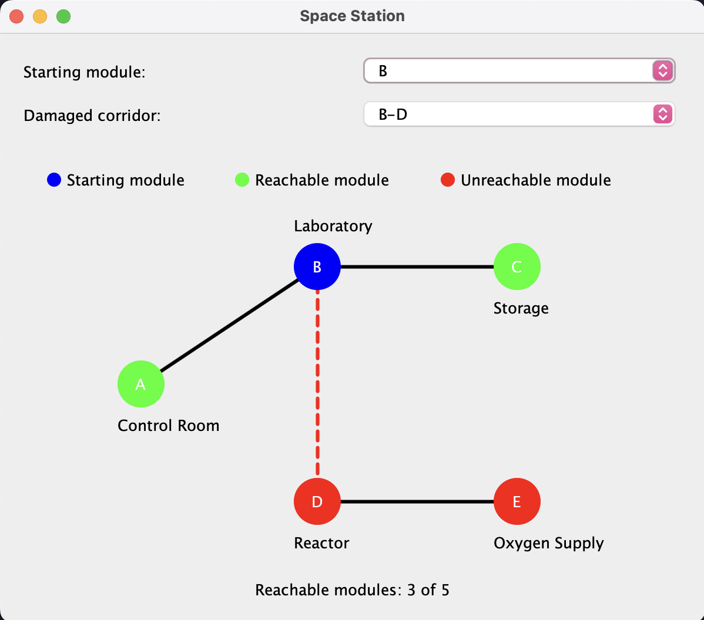

# Space Station – BFS Visualization

A simple Java Swing application that demonstrates the **Breadth-First Search (BFS)** algorithm on an undirected graph.

The application simulates a space station consisting of five interconnected modules. It determines which modules remain reachable when one of the connecting corridors is damaged.

## Features

- Select a starting module (A–E).
- Select a damaged corridor.
- Find reachable modules using BFS.
- Visualize the graph and its connections.
- Automatically update the visualization when selections change.
- Display the number of reachable modules.

## Graph Structure

The space station consists of five modules:

| Module | Name |
|---|---|
| A | Control Room |
| B | Laboratory |
| C | Storage |
| D | Reactor |
| E | Oxygen Supply |

The modules are connected by four undirected edges: A–B, B–C, B–D, and D–E.

## Algorithm

The application uses **Breadth-First Search (BFS)** to determine which modules are reachable from the selected starting module.

BFS explores the graph using a queue (`Queue`). The damaged corridor is ignored in both directions, while visited modules are stored in a set (`Set`) to prevent repeated processing.

## Visualization

- 🔵 Blue – Starting module
- 🟢 Green – Reachable module
- 🔴 Red – Unreachable module
- Red dashed line – Damaged corridor

## Preview

## Technologies

- Java
- Java Swing
- Maven

## Getting Started

**Requirements:** JDK 21 or newer and IntelliJ IDEA.

1. Clone or download the repository.
2. Open the project in IntelliJ IDEA.
3. Run `Main.java`.

No database or external services are required.